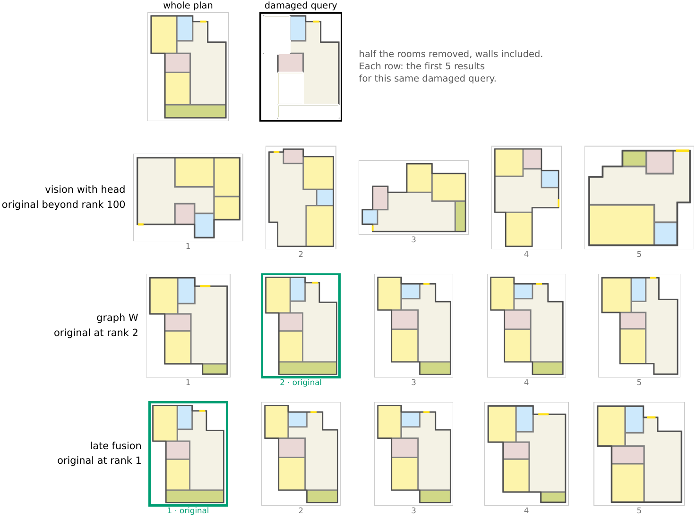
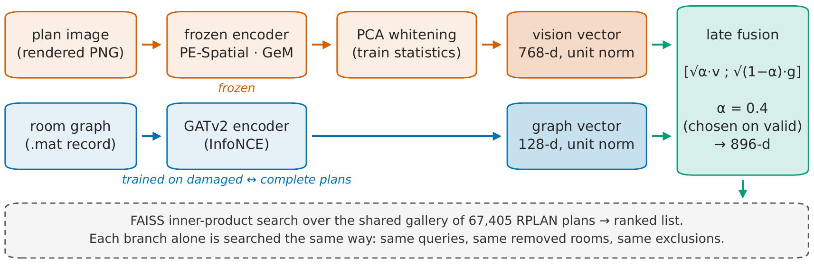
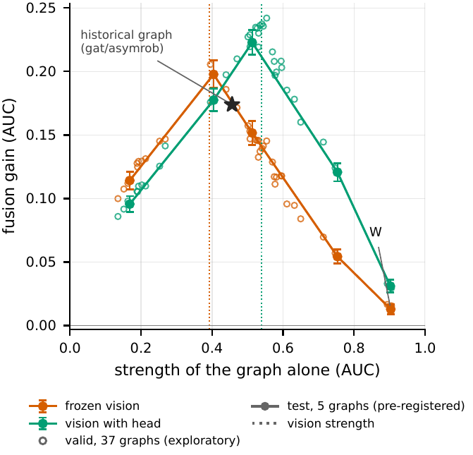

<div align="center">

# FusePlan

**Separating Complementarity from Ensemble Effects in Partial Floor Plan Retrieval**

Giuseppe Angelillis · Enrico Di Maria · Gabriele Germini
<br>University of Modena and Reggio Emilia

[](main.pdf)
[](FusePlan%20–%20Presentation.pdf)
[](main.tex)
[](#dataset-and-protocol)

[Overview](#overview) • [Method](#method) • [Results](#results) • [Repository](#repository-contents) • [Build](#building-the-paper) • [Citation](#citation)



</div>

## Overview

Architects rarely start from a complete floor plan: they sketch a few rooms or reuse a fragment, then look for complete plans that contain it. Floor-plan retrieval methods, however, train and evaluate on complete plans. FusePlan studies **retrieval from incomplete queries**: remove part of a plan's rooms and find the source among all 67,405 RPLAN plans.

A plan exists both as an image and as a graph of rooms, and the two fail in different ways. Fusing them improves retrieval, but **any fusion of two models with partly independent errors improves**, even when the second model knows nothing new. The paper separates the two effects with *ensemble controls* and a *complementarity gain*.

Main contributions:

- **Graph branch for incomplete plans.** A GATv2 encoder trained on damaged ↔ complete pairs and selected on robustness reaches an AUC of 0.903 on test, 0.29 above LayoutGKN retrained on the same task.
- **Ensemble controls and complementarity gain.** Every vision–graph fusion is compared with a fusion of the graph with a second graph model; the complementarity gain (CG) is the part of the gain the control does not reach.
- **Relative strength.** Across 37 graphs, the fusion gain follows an inverted U and peaks when the two branches are equally strong.
- **Protocol and negative results.** Three damages, paired bootstrap intervals, four replicas and pre-registered test readings, plus the failures that shaped them.

## Method

<p align="center">
  
</p>

| Component | Design |
|---|---|
| Vision branch | Frozen PE-Spatial (ViT-B/16) · GeM pooling · PCA whitening on training plans → 768-d. Optional damage-trained head (single-damage, 256-d, or multi-damage). |
| Graph branch | Rooms as nodes (type + box), adjacencies as typed edges · 3-layer GATv2 · symmetric InfoNCE on asymmetric pairs (complete plan ↔ plan with 25–75 % of rooms removed) · checkpoint selected on retrieval robustness → 128-d. |
| Late fusion | `z = [√α·v ; √(1−α)·g]`, so the inner product is α·cos_v + (1−α)·cos_g; one exact FAISS search over the gallery. α chosen on validation (0.4 with the frozen branch). |
| Complementarity gain | `CG = gain(V+G) − gain(C*)`, where C* is the stronger ensemble control (a second training of the graph, or a GraphSAGE graph). CG > 0 means the image adds information of its own. |

## Results

Room removal on the test split. The AUC averages the reciprocal rank of the source plan over 25, 50 and 75 % of rooms removed (1 = always first); mean ± std over four replicas.

| System | AUC |
|---|---|
| Room-type histogram | 0.001 |
| Frozen vision (PE-Spatial) | 0.392 ± 0.005 |
| Single-damage vision head | 0.531 ± 0.001 |
| LayoutGKN, retrained (one run) | 0.611 |
| **Graph W (GATv2)** | **0.904 ± 0.001** |
| W + frozen vision | 0.916 ± 0.001 |
| W + single-damage head | 0.932 ± 0.001 |
| **W + multi-damage head** | **0.940 ± 0.001** |

Complementarity gain with the strong graph W (test, mean of four replicas, AUC):

| Fusion | Fusion gain | Control gain | CG [95 % CI] |
|---|---|---|---|
| + frozen vision | +0.0125 | +0.0163 | −0.0038 [−0.0067, −0.0010] |
| + single-damage head | +0.0279 | +0.0163 | +0.0116 [+0.0085, +0.0148] |
| + multi-damage head | +0.0366 | +0.0163 | +0.0203 [+0.0171, +0.0235] |

> [!IMPORTANT]
> With a graph near the ceiling, a frozen image encoder adds no more than a second graph model. Damage-trained vision heads carry information of their own, yet the control still explains about half of their gain: reporting the raw fusion gain would overstate the contribution of the image by about a factor of two.

<p align="center">
  
</p>

The fusion gain depends on the relative strength of the branches: it peaks at +0.198 when graph and image are equally strong and shrinks to +0.013 as the graph approaches the ceiling. The image helps most where the graph has little left, at 75 % removal and on plans with five rooms or fewer.

## Dataset and protocol

- **Dataset:** [RPLAN](http://staff.ustc.edu.cn/~fuxm/projects/DeepLayout/index.html), 67,405 plans with both a rendering and a structural record; official split of 47,126 / 10,152 / 10,127 plans.
- **Queries:** 2,000 validation and 2,000 test plans with 25, 50 or 75 % of their rooms removed; crop and patch damages are used to select the vision branch.
- **Protocol:** every choice (configuration, checkpoint, fusion weight) is made on validation. Predictions were written before each test reading, and the test split was read once with all weights fixed.

> [!NOTE]
> RPLAN only, with synthetic damages; graphs come from exact records, not from parsed images. See the Limitations paragraph of the paper.

## Repository contents

```
├── main.tex, preamble.tex     # paper entry point and packages (CVPR 2026 template)
├── sec/                       # abstract, introduction, related work, method, experiments, conclusions, supplementary
├── figures/english/           # figures included by the paper
├── assets/                    # PNG renderings of three figures for this README
├── main.bib                   # references
├── cvpr.sty, ieeenat_fullname.bst
├── main.pdf                   # compiled paper
├── FusePlan – Presentation.pdf
└── FusePlan – Presentation script.pdf   # speaker notes for the talk
```

## Building the paper

Requires a LaTeX distribution with `pdflatex` and `bibtex` (TeX Live or MiKTeX).

```bash
pdflatex main
bibtex main
pdflatex main
pdflatex main
```

> [!TIP]
> The supplementary material is in `sec/X_suppl.tex`; uncomment `\input{sec/X_suppl}` in `main.tex` to include it.

## Citation

```bibtex
@misc{angelillis2026fuseplan,
  title  = {FusePlan: Separating Complementarity from Ensemble Effects in Partial Floor Plan Retrieval},
  author = {Angelillis, Giuseppe and Di Maria, Enrico and Germini, Gabriele},
  year   = {2026},
  note   = {University of Modena and Reggio Emilia}
}
```
